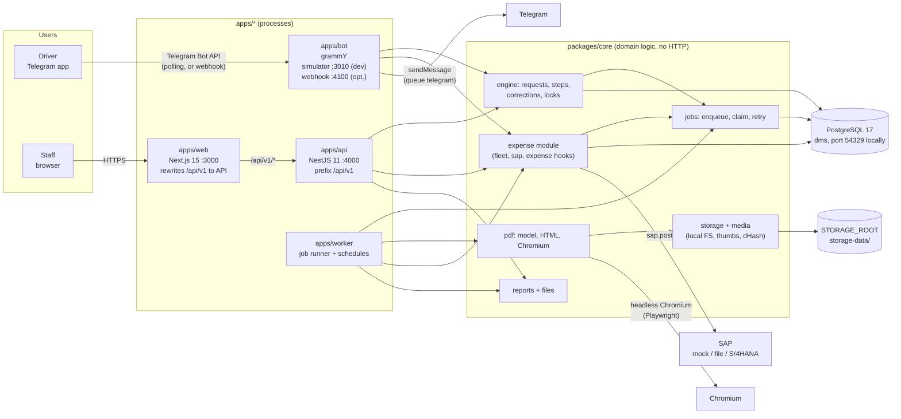
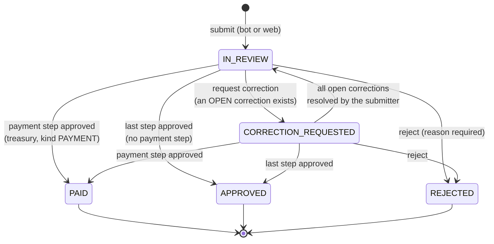
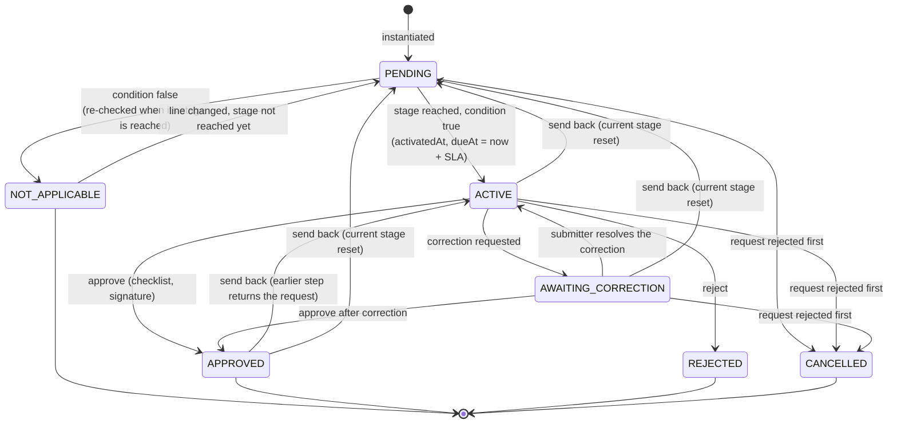
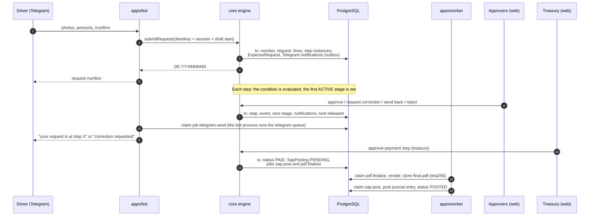
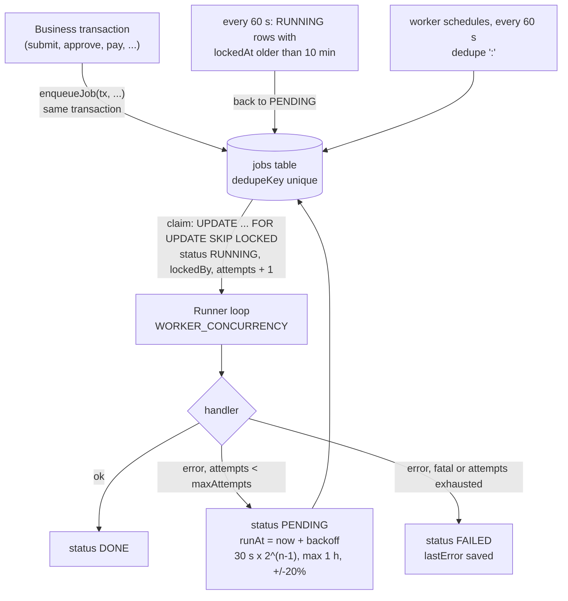
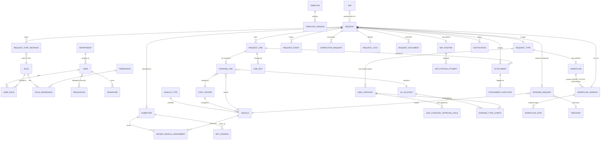

# Architecture

This describes the system as built. Source of truth for the design decisions: `docs/PLAN.md` and `docs/DECISIONS.md`. The database schema is `packages/db/prisma/schema.prisma`.

## 1. Components



Key points:

- **Bot and worker call `@dms/core` directly against the database.** There are no internal HTTP calls between processes (PLAN D6). The jobs table is both the queue and the transactional outbox: a job exists if and only if the business change committed.
- **Only the bot holds the Telegram token.** Outgoing Telegram messages are jobs on the `telegram` queue, consumed by the bot process. Everything else runs on the `default` queue in the worker.
- **The web app is the only browser client of the API.** It uses the API's `/api/v1` routes; the Next.js rewrite keeps everything on one origin.
- **Files** are stored under `STORAGE_ROOT` and served only through signed URLs (`GET /api/v1/files/:keyB64`).

### 1.1 Repository layout

| Path | Package | Role |
|---|---|---|
| `packages/shared` | `@dms/shared` | Browser-safe constants (permissions, roles, settings defaults), zod schemas, pure helpers (digits, amounts, Cairo dates, decimal math), API contract types. The only package the web imports. |
| `packages/db` | `@dms/db` | Prisma schema and migrations, client factory, `loadEnv()`, local PostgreSQL scripts (`scripts/pg.ts`), base seed (`prisma/seed.ts`), test database helper (`@dms/db/testing`). |
| `packages/core` | `@dms/core` | Domain services. Subpath imports only (for example `@dms/core/engine`); no root index. |
| `apps/api` | `@dms/api` | NestJS controllers, guards and validation. Folders: `platform` (auth, users, roles, master data, settings, notifications), `workflow` (requests, request types, workflows, templates), `expense` (expense module API), `integrations` (documents and SAP monitor), `reports`, `files`, `health`, `common`. |
| `apps/web` | `@dms/web` | Next.js 15 App Router, Tailwind 3.4, TanStack Query. Route groups: `/login` and `(app)` (inbox, requests, vehicle changes, assignments, master data, admin, workflows, templates, SAP, reports, dashboard, notifications, profile). |
| `apps/bot` | `@dms/bot` | grammY bot: onboarding, the expense flow, "my requests", corrections, `telegram.send` job handler, driver simulator (`BOT_SIMULATOR=1`). |
| `apps/worker` | `@dms/worker` | Job runner and schedules (SLA scan, draft sweep, export expiry), jobs `sap.post`, `pdf.finalize`, `report.export`. |
| `e2e` | `@dms/e2e` | Playwright browser tests. |

### 1.2 Generic core versus the expense module

The design splits the system into a generic request/approval core and one module that adds the business meaning of a driver expense claim.

| Generic core (usable for other request types) | Expense module (`packages/core/src/{expense,fleet,sap}`, `apps/api/src/expense`) |
|---|---|
| Departments, users, roles, permissions, delegations, sessions, audit log | Vehicles, vehicle types, cost centers, GL accounts |
| Submitters (any external requester; a driver is `kind = DRIVER`) | Driver-to-vehicle assignments and vehicle change requests |
| Request types, line categories (expense types), per-category extra fields, attachment rules, additional approval roles | Treasuries (cash GL and company code per treasury) |
| Workflows (versions, steps, conditions, parallel stages), templates (versions, layout key) | `ExpenseRequest` (vehicle, odometer, cost center, treasury), `ExpenseLine` (GL and cost center snapshot), `ExpenseTypeConfig` (GL per expense type) |
| Requests, lines, attachments, duplicate flags, step instances, corrections, events, locks | SAP journal entry, `SapPosting`, `SapPostingAttempt`, SAP adapters |
| Notifications, jobs, documents (PDF), storage, reports, signed files | Odometer checks, stopped-vehicle block, bot-specific vehicle rules |

A module plugs into the core through a registry keyed by `RequestType.moduleKey`. The expense module registers itself with `registerExpenseModule()` at start-up (API, bot, worker and tests). Its hooks run inside the core transaction: `validateSubmission`, `afterCreate`, `conditionFacts`, `onLineChanged`, `beforeApprove`, `onPaid`, `onRejected`, `detailExtras`, `templateData`, `listSummary`.

The rule is that the core never imports the module. The one exception is `packages/core/src/pdf/fixtures.ts`, a test fixture that builds a paid expense request and so imports the SAP journal builder.

## 2. Request lifecycle

### 2.1 Request status

`Request.status` (enum `RequestStatus`). Terminal states are `APPROVED`/`PAID` (completed) and `REJECTED`. `CANCELLED` exists in the enum but nothing sets it yet.



`status` becomes `PAID` when the payment step is approved (and the request has a payment step), otherwise `APPROVED` when the last step completes. The expense module then creates the SAP posting and the final PDF jobs.

### 2.2 Step instance status

Each workflow step becomes one `RequestStepInstance` per request (one per role step, plus one per extra role for the dynamic slot). Conditions decide whether it applies.



### 2.3 Submit to payment (sequence)



Both `submitRequest` and every approver action run in one transaction that starts with `SELECT ... FOR UPDATE` on the request row, re-checks the state, bumps `rowVersion`, and writes the `RequestEvent` and the audit entry. Locks (`RequestLock`) are taken when a user opens an action panel and expire after `workflow.lockTimeoutMinutes` (default 15).

## 3. Jobs and outbox



| Queue | Job type | Trigger | Handler |
|---|---|---|---|
| `default` (worker) | `sap.post` | Payment (see `docs/SAP_INTEGRATION.md`, including the known payload issue) | `processSapPosting` |
| `default` | `pdf.finalize` | Payment | `finalizeRequestPdf` (idempotent: an existing final document is returned) |
| `default` | `report.export` | User asks for an export | `runExport` |
| `default` | `sla.scan` | Every 5 min | `runSlaScan`: reminders for overdue ACTIVE steps |
| `default` | `bot.draft_sweep` | Every 15 min | `sweepBotDrafts`: reminder, then expiry of abandoned drafts |
| `default` | `exports.sweep` | Every hour | `expireExports` |
| `default` | `email.send` | Not scheduled | Stub: consumed and skipped |
| `telegram` (bot) | `telegram.send` | Any notification for a submitter | Sends the Telegram message; no chat id means the notification is `SKIPPED` |

Every handler must be idempotent, because stale-lock recovery can run a job twice. The worker takes `WORKER_CONCURRENCY` loops (default 2).

## 4. Data model overview

Tables are snake_case, columns are camelCase (PLAN and CLAUDE.md rules). Money is a decimal string in the API. The diagram shows the main tables and relations; the schema has more columns and indexes.



Other tables: `Session` (refresh tokens), `AuditLog`, `Setting` (key/value settings), `RequestNumberCounter` (per prefix and year), `Permission`, `RolePermission`, `Delegation`, `VehicleChangeRequest`, `ReportExport`, `BotSession`.

Request numbers: `DE-YY-NNNNNN` for driver expenses (prefix `DE`), from `RequestNumberCounter` with an atomic upsert.

## 5. Where to look in the code

| Concern | Path |
|---|---|
| Submit, actions, corrections, locks, conditions | `packages/core/src/engine` |
| Expense hooks, expense types, treasury payment | `packages/core/src/expense` |
| Vehicles, assignments, change requests | `packages/core/src/fleet` |
| SAP journal, adapters, posting process | `packages/core/src/sap` |
| Jobs, runner, schedules | `packages/core/src/jobs`, `apps/worker/src/handlers.ts` |
| Attachments, thumbnails, duplicates | `packages/core/src/media`, `packages/core/src/storage` |
| PDF | `packages/core/src/pdf` |
| Reports, exports | `packages/core/src/reports` |
| Settings and configuration reads | `packages/core/src/config` |
| Permissions and roles | `packages/shared/src/constants/permissions.ts`, `packages/core/src/rbac` |
| Bot flow and messages | `apps/bot/src/flow.ts`, `apps/bot/src/messages.ts` |

## 6. Monitoring

`GET /api/v1/metrics` serves Prometheus text format (0.0.4). Access: when `METRICS_TOKEN` is set, send `Authorization: Bearer <token>`; when it is not set the route is open outside production and returns 404 in production.

```yaml
scrape_configs:
  - job_name: dms
    metrics_path: /api/v1/metrics
    authorization:
      type: Bearer
      credentials: <METRICS_TOKEN>
    static_configs:
      - targets: ['dms-host:4000']
```

| Metric | Type | Labels | Meaning |
|---|---|---|---|
| `dms_http_requests_total` | counter | method, route, status | HTTP requests (route is the templated path) |
| `dms_http_request_duration_seconds` | histogram | method, route | Request duration |
| `dms_process_uptime_seconds` | gauge | - | Process uptime |
| `dms_process_resident_memory_bytes` | gauge | - | Resident memory |
| `dms_process_heap_used_bytes` | gauge | - | Heap in use |
| `dms_db_up` | gauge | - | 1 when `SELECT 1` works |
| `dms_jobs` | gauge | queue, status | Jobs by queue and status |
| `dms_jobs_oldest_pending_age_seconds` | gauge | queue | Age of the oldest runnable PENDING job |
| `dms_sap_postings` | gauge | status | SAP postings by status |
| `dms_notifications` | gauge | channel, status | PENDING and FAILED notifications |
| `dms_requests` | gauge | status | Requests by status |
| `dms_steps_overdue` | gauge | - | ACTIVE steps past their due date |
| `dms_build_info` | gauge | version | Always 1; version from the root `package.json` |
